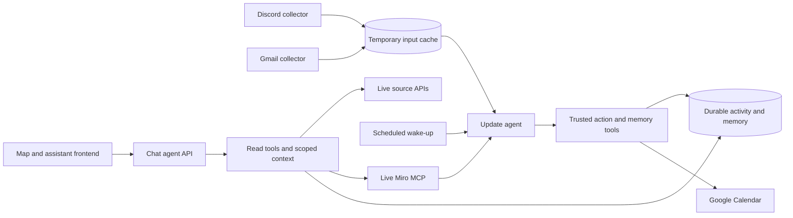

# Initial MVP architecture

Status: user-confirmed initial MVP direction (2026-10-17), with current implementation distinguished from planned work. The user plans substantial frontend changes; keep backend contracts explicit and allow independent UI work. No new migrations or infrastructure changes follow from this documentation pass.

## Current implementation

The **chat agent** is the user-facing conversational assistant, served by the Chat API. The **update agent** is the backend autonomous processor, run by the automation worker. These are the project’s agent names; API and worker describe their runtime components.

One repository contains the Vite/Three.js frontend, Hono API, model adapters, automation runner, source connectors and callable tools. Two independent Railway collector services currently exist:

| Component | Current state | Responsibility |
| --- | --- | --- |
| Discord collector | Deployed as discord-events | New native create/edit/delete events, inherited blacklist/manual-disable checks, metadata discovery; no message backfill or model calls. |
| Gmail collector | Deployed as gmail-events | Authenticated Pub/Sub callback, incremental history, watch renewal and enqueue; GMAIL_EVENTS_ENABLED is independent of the agent switch. |
| Miro live reader | Shared official MCP in both agents | Request-local search/canvas/table evidence; no REST snapshot tool, service or stored board contents. |
| Chat agent (Chat API) | Implemented for local use; no Railway service | Interactive model/tool requests and protected administration. Production member authentication remains unfinished. |
| Update agent (automation worker) | Implemented locally; not deployed/enabled for model work | Reads due cache batches, prepares fresh scoped Miro context, reconciles managed events through fixed-target Calendar tools and removes only successfully handled inputs. |
| Frontend | Implemented locally; hosting not verified in this pass | Campus map, assistant and admin UI. Current map rendering is not proof of durable agent-written activity integration. |

The shared Supabase project currently has eleven service-only tables: discord_view_policies, knowledge_sources, bug_reports, agent_input_cache, agent_automation_state, map_people, map_buildings, events, event_buildings, event_people and event_types. The cache has exactly uuid/raw_response. It holds temporary pending inputs, while the automation-state table holds operational metadata. Discord content has no historical archive, durable summary/vector store or backfill. Miro reads board contents live via MCP; knowledge_sources retains only identity/status and enabled/team configuration. Applied SQL is immutable.

Callable read tools live under tools/{discord,google,miro}; connector API clients and source-policy enforcement remain under server/. Developer/deployment utilities live under scripts/. Entrypoints select trusted tools; collectors do not import callable tool registries, model runners or provider configuration. Current source access is shared, with server allowlists/current policy and backend admin checks.

## Confirmed MVP direction

Keep one repository with independently deployable components. The user accepted this as the initial MVP direction; expand after the core workflow works. The frontend, chat agent API and update agent worker have separate runtime lifecycles. Discord/Gmail collectors can each be disabled or redeployed independently; Miro is a direct MCP connection within each agent. Shared code is imported at build/runtime boundaries, without creating an additional tool-hosting service. The chat agent and update agent share tool implementations. The user’s target is the same tool catalog for both, with different prompts; exact tool exposure and registry wiring are a follow-up discussion. Source access and concrete execution permissions remain enforced by backend code. Chat Calendar tools use a stable catalogue; the model interprets whether the current request asks for a change, while backend Google grants, fixed targeting, validation and fresh revisions govern execution. No Calendar wording parser acts as a permission gate.

This diagram shows the agreed direction; it is not a claim of completed implementation. Scheduled wake-ups, Miro event-to-cache production, durable activity/memory schemas, update_memory and deployed chat/automation services remain unimplemented or inactive. Shared normalized map-event tools are implemented and registered in the update-agent adapter, while worker activation remains separate. The current automation defaults are 30 eligible inputs or oldest age 30 minutes plus a one-minute cooldown; a production wake-up interval is not yet agreed. A cron-only process detects thresholds when it wakes, rather than immediately on the 30th arrival.

Collectors gather source changes and preserve identities/freshness; automation interprets them and applies permitted changes. Shared database access should use explicit ownership/RPC contracts so each integration does not become dependent on all other tables. Existing service credentials are not proof of per-service least-privilege database roles.

Core operator instructions should remain separate from agent-editable short/long-term context. Memory updates should use a bounded update_memory tool with scope, provenance and versioning. This is design direction only: no prompt/memory migration was requested.

## Implementation decisions still open

- Implement separate chat agent API and update agent worker deployments sharing tool/provider code.
- Wire the intended shared tool catalog into both runtimes, with different prompts and explicit authorization; discuss exact exposure before implementing it.
- Define durable activity/memory ownership and complete production Calendar/runtime verification; local Calendar tools use managed event ownership.
- Choose production scheduling, source-event treatment for Miro and member authentication in their own implementation passes.

## Verification and handoff

Cleanup commits:238a346 (source/build/tests),48ad290 (docs/evidence). M38 passed581/581 tests,55/55 focused checks and both builds. Gmail revision8f10ca33-b53b-4358-96d9-b2becdf6f5e5 is healthy with collection enabled/model disabled. Hosted Discord edit/delete/blacklist and admin browser probes remain pending; local fixtures pass. Unrelated map/UI/artwork changes are preserved outside the cleanup commits.

See cleanup-handoff.md for file ownership, backend-direction.md for current backend details, database-tables.md for actual schema and ../milestones/milestone.md for the rolling state. Update this document when the user resolves the remaining implementation details. This confirmation does not expand Google OAuth scopes, grant source writes or authorize prompt/memory migrations.

## Normalized map activity (2026-10-18)

The hosted events/event_buildings/event_people model replaces both building-owned activity JSON columns through026/027. Buildings are a fixed catalogue; profiles remain separate. Map avatars and schedules derive from source-authorized participation windows, and all participants can display at all event buildings simultaneously. Shared read/identity/upsert tools use the same trusted event service and optimistic RPC. The bundled update-agent adapter registers these tools and binds changes to supporting queued/live evidence; the chat agent does not yet register them. No worker was enabled/deployed by this implementation, and mandatory Calendar preflight/owner sharing remains unresolved. See events.md and the rolling milestone for exact schema, hosted receipts and checks.

028adds the immutable five-type catalogue and events.type_id. Agent tools select a known type while catalogue metadata/icons remain owner-controlled. Building cards include all authorized unexpired record kinds, not just scheduled club events. This is a display/classification change; future narrowing of event write fields and worker activation remain separate.

Event-type icon generation/rendering was cancelled by the user after two rejected samples. Fixed categories remain; no category images are bundled or loaded. Applied028icon_key is retained only as compatibility metadata. Attendee/people/building portraits are independent and preserved.

Miro030cutover is hosted at20261018174413. The old miro-sync Railway service is deleted; live chat and isolated update preparation both read MCP successfully. Current Calendar preflight returns owner access. The update worker remains disabled and undeployed; no Calendar events were changed by this cutover.
