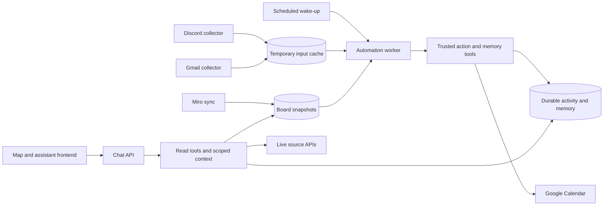

# Architecture alignment draft

Status: current implementation facts plus a target for discussion with the user. Target deployment and data-model decisions below are proposals, not completed work. No migrations or infrastructure changes follow from this document.

## Current implementation

One repository contains the Vite/Three.js frontend, Hono API, model adapters, automation runner, source connectors and callable tools. Three independent Railway services currently exist:

| Component | Current state | Responsibility |
| --- | --- | --- |
| Discord collector | Deployed as discord-events | New native create/edit/delete events, inherited blacklist/manual-disable checks, metadata discovery; no message backfill or model calls. |
| Gmail collector | Deployed as gmail-events | Authenticated Pub/Sub callback, incremental history, watch renewal and enqueue; GMAIL_EVENTS_ENABLED is independent of the agent switch. |
| Miro sync | Provisioned as miro-sync, paused | Scoped board snapshots preserving original objects/layout; no model calls. |
| Chat API | Implemented for local use; no Railway service | Interactive model/tool requests and protected administration. Production member authentication remains unfinished. |
| Automation worker | Implemented locally; not deployed/enabled for model work | Reads due cache batches, executes explicitly supplied trusted tools, removes only successfully handled inputs. |
| Frontend | Implemented locally; hosting not verified in this pass | Campus map, assistant and admin UI. Current map rendering is not proof of durable agent-written activity integration. |

The shared Supabase project currently has five service-only tables: discord_view_policies, knowledge_sources, miro_boards, agent_input_cache and agent_automation_state. The cache has exactly uuid/raw_response. It holds temporary pending inputs, while the automation-state table holds operational metadata. Discord content has no historical archive, durable summary/vector store or backfill. Miro retains board snapshots separately. Applied SQL is immutable.

Callable read tools live under tools/{discord,google,miro}; connector API clients and source-policy enforcement remain under server/. Developer/deployment utilities live under scripts/. Entrypoints select trusted tools; collectors do not import callable tool registries, model runners or provider configuration. Current source access is shared, with server allowlists/current policy and backend admin checks.

## Proposed target to confirm

Keep one repository with independently deployable components. Frontend, interactive Chat API and background Automation Worker have separate runtime lifecycles. Discord/Gmail/Miro collectors can each be disabled or redeployed independently. Shared code is imported at build/runtime boundaries, without creating an additional tool-hosting service.

This diagram is a target. Scheduled wake-ups, Miro event-to-cache production, durable activity/memory schemas, Calendar/map write adapters, update_memory and deployed chat/automation services remain unimplemented or inactive. The current automation defaults are five eligible events or oldest age five minutes plus a cooldown; a production wake-up interval is not yet agreed. A cron-only process detects thresholds when it wakes, rather than immediately on the fifth arrival.

Collectors gather source changes and preserve identities/freshness; automation interprets them and applies permitted changes. Shared database access should use explicit ownership/RPC contracts so each integration does not become dependent on all other tables. Existing service credentials are not proof of per-service least-privilege database roles.

Core operator instructions should remain separate from agent-editable short/long-term context. Memory updates should use a bounded update_memory tool with scope, provenance and versioning. This is design direction only: no prompt/memory migration was requested.

## Decisions for discussion

- Confirm separate Chat API and Automation Worker deployments sharing tool/provider code.
- Confirm keeping one repository with independent deployment packages rather than splitting repositories now.
- Define ownership of durable activity, memory and Calendar edits before implementing write tools.
- Choose production scheduling, source-event treatment for Miro and member authentication in their own implementation passes.

## Verification and handoff

Cleanup commits:238a346 (source/build/tests),48ad290 (docs/evidence). M38 passed581/581 tests,55/55 focused checks and both builds. Gmail revision8f10ca33-b53b-4358-96d9-b2becdf6f5e5 is healthy with collection enabled/model disabled. Hosted Discord edit/delete/blacklist and admin browser probes remain pending; local fixtures pass. Unrelated map/UI/artwork changes are preserved outside the cleanup commits.

See cleanup-handoff.md for file ownership, backend-direction.md for current backend details, database-tables.md for actual schema and ../milestones/milestone.md for the rolling state. This draft will be revised after architecture discussion; it is not authorization to deploy or add schemas.
